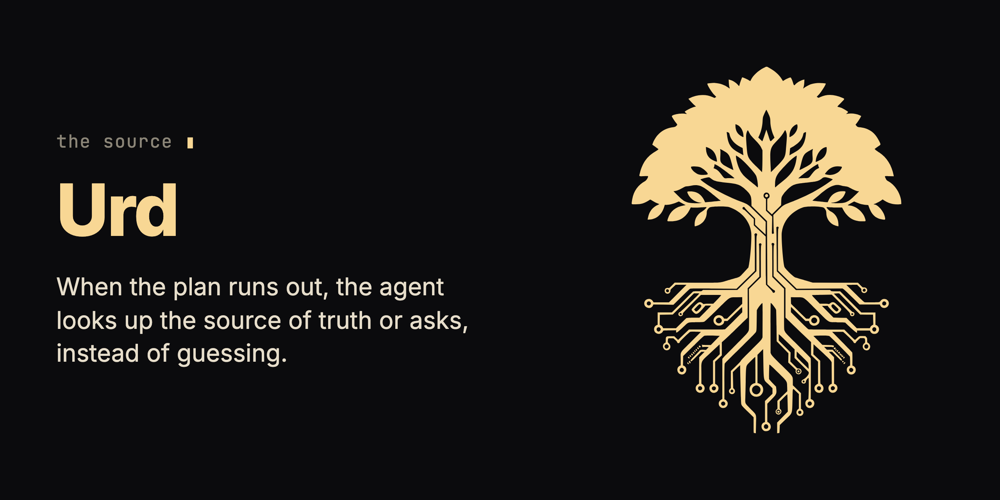

<p align="center"></p>

# Urd

**Your AI agent hit a gap in the spec, so it guessed, and shipped.** Urd makes it stop and ask instead.

Urd is one skill file. When the agent moves from a plan into code and the plan runs out, it makes the agent check the source of truth or ask you, with options and a recommendation.

## What you install

In Claude Code:

```
/plugin marketplace add krzysztofdudek/UrdSkill
/plugin install urd@urd-marketplace
```

Then run `/reload-plugins` or restart Claude Code. No config, no API key.

| Piece | Where it lands | What it does | When it acts |
|---|---|---|---|
| The Urd skill, one Markdown file ([`skills/urd/SKILL.md`](skills/urd/SKILL.md)) | your Claude Code plugins | Tells the agent when to stop and ask, and how to ask. | When the agent moves from a plan, a design doc or a spec into implementation. |

- **Never touches:** your repository, your git, the network. It installs no hook, no MCP server and no command.
- **Needs:** an agent that reads skills.
- **Costs:** none of its own. The skill file is about 900 words, read when the skill fires.
- **In the agent's context:** the skill's description always; the body when it fires.

<details>
<summary>Other agents: GitHub Copilot CLI, Cursor, a plain skill folder</summary>

GitHub Copilot CLI:

```
copilot plugin marketplace add krzysztofdudek/UrdSkill
copilot plugin install urd@urd-marketplace
```

Cursor:

```
git clone https://github.com/krzysztofdudek/UrdSkill.git
ln -s "$(pwd)/UrdSkill" ~/.cursor/plugins/local/urd
```

Then **Developer: Reload Window**.

A plain skill folder: copy [`skills/urd/SKILL.md`](skills/urd/SKILL.md) to `~/.claude/skills/urd/SKILL.md` (user level) or `.claude/skills/urd/SKILL.md` (project level), `~/.cursor/skills/urd/SKILL.md` for Cursor, or wherever your agent reads skills.

</details>

## What changes on the first day

- When the spec is silent on a case the agent hits, it stops and asks instead of picking something.
- When the spec contradicts itself, it names both sides and asks.
- Before it adds a fallback, an exception or a `TODO` the spec did not sanction, or weakens a test to make code pass, it asks.
- Its question names the step, quotes the spec, says what does not fit, gives numbered options and its recommendation.
- It labels what it believes but has not checked, and re-reads the source when you challenge a claim.

## Start

1. Install with the two commands above.

   You see: `urd` among your plugins after the reload.

2. Hand the agent a plan and let it implement. For example, a plan step that says "On 5xx response, retry up to 3 times with exponential backoff."

   You see: when the agent hits a case the plan does not cover, such as a 429, it stops with a question like this one.

   > **Question: retry logic, step 4.** The plan covers 5xx, but I've hit **429 (rate-limited)**: not 5xx, yet retryable. The spec doesn't say how to treat it. Three options:
   >
   > 1. Treat 429 like 5xx: retry with backoff.
   > 2. Honor the `Retry-After` header if present, otherwise back off.
   > 3. Leave 429 to the caller: don't retry it here.
   >
   > I'd go with (2). Proceed?

3. Answer with a number.

   You see: the agent carries on with your choice. Well-written plans trigger few stops, and sparse plans trigger many.

## What it does not do

- It biases the agent toward asking; it is not a runtime guarantee that the agent always stops.
- It does not fix a vague spec for you; it shows you the gaps.
- It does not remove bugs.
- It is the wrong tool if you want a fast pass with every deviation resolved silently.

## Remove it

In Claude Code:

```
claude plugin uninstall urd@urd-marketplace
claude plugin marketplace remove urd-marketplace
```

On Copilot CLI, `copilot plugin uninstall urd@urd-marketplace`. On Cursor, delete the link in `~/.cursor/plugins/local/urd`. A copied skill file is removed by deleting it. Urd leaves nothing in your repository.

## Where it fits

Urd is an add-on of the family: it attaches to the agent, depends on no other family tool and keeps its own version. Inside a Horde mission it is the stop a worker hits before it guesses, and inside a Jarl loop the jarl itself follows it.

Read more: [The skill](skills/urd/SKILL.md) · [Changelog](CHANGELOG.md) · [Report a problem](https://github.com/krzysztofdudek/UrdSkill/issues)

## The Yggdrasil family

**[Jarl](https://github.com/krzysztofdudek/JarlSkill)** is the loop. **[Yggdrasil](https://github.com/krzysztofdudek/Yggdrasil)** is the law. **[Grain](https://github.com/krzysztofdudek/Grain)** is the survey. **[Horde](https://github.com/krzysztofdudek/Horde)** plans the mission onto the law before anyone writes, lands every change through a gate no agent can argue with, and turns what the mission learned into law. It runs on Jarl's loop, with Grain in the architect's hands. Those four are the core, and they ship under one version number, Jarl on it from 6.1.0: one set of tools built and tested against each other. Yggdrasil, Grain and Jarl each work alone; Horde is the one built on the other three. Where a repository has a check, the check decides what lands, in a Horde mission and in a Jarl loop alike: a fresh reviewer can only stop a change, never make a failing check pass, and its word is recorded as testimony. A Jarl loop in a repository with no check lands on testimony alone, and says so. Law that stays inside one component is raised freely by the agent working it. Law or decisions that reach a whole type of code are shared vocabulary: the agent proposes them and they run as advice at once, and the client, the one person the whole system answers to, admits them in one batch when the work closes. Only the client lowers or vetoes law. The core's shared machine contracts are registered on [one page](https://krzysztofdudek.github.io/Yggdrasil/family-contracts).

Start at the step where it hurts.

| Where it hurts | Start with |
|---|---|
| More issues than one agent can hold in its head | **Jarl** |
| The agent keeps breaking what was agreed | **Yggdrasil** |
| Nobody knows what was agreed | **Grain**, which earns its keep the moment you are about to write law |
| A task too big for one head to plan up front, in a repository that already has law | **Horde** |

| Core | What it holds |
|---|---|
| **[Jarl](https://github.com/krzysztofdudek/JarlSkill)** | The loop. Everything seen becomes an issue, each issue gets one worker in its own worktree, nothing closes without evidence and a review, and no code closes without a fresh reviewer's word. Rulings keep their history, and a ruling about a whole type of code goes to the client in one batch when the loop closes. |
| **[Yggdrasil](https://github.com/krzysztofdudek/Yggdrasil)** | The law. The architecture graph, the rules over it and the log of why, checked before the agent moves on and re-proved in CI without a key. A rule that reaches a whole type runs as advice until the client ratifies it. |
| **[Grain](https://github.com/krzysztofdudek/Grain)** | The survey. Mines a repository's own code and history into a first graph: components, dependencies, and the rules the code already keeps, each with the count of places that break it today; Yggdrasil accepts it with one command. It measures and never blocks. |
| **[Horde](https://github.com/krzysztofdudek/Horde)** | The mission on the law. A one-shot architect plans the whole mission onto the graph once, measuring with Grain; a worker per ticket in its own worktree; every change lands through a nine-item gate; what the mission learned becomes law. Its record is a Jarl loop. The client orders the mission and is the only one who can lower or veto a rule. |

Three add-ons attach to the agent rather than to the graph; each works alone, depends on nothing in the family and keeps its own version. Horde doesn't assume any of them is installed, since it carries its own minimum discipline in each role's law. It uses Ratatoskr, Urd and Researcher when they are, one sentence per row below.

| Add-on | Stage | What it makes the agent prove | In Horde's loop |
|---|---|---|---|
| **[Ratatoskr](https://github.com/krzysztofdudek/RatatoskrSkill)** | request → intent | Keeps the agent talking to you in plain words, not code, so you can follow what it's doing. | Keeps the client's plain-language registry open at both ends of a mission. |
| **Urd** (this one) | intent → code | When the spec is ambiguous, it consults the source of truth and asks, it doesn't guess. | The stop a worker hits before it guesses. |
| **[Researcher](https://github.com/krzysztofdudek/ResearcherSkill)** | code → measured result | Point it at a metric and it runs experiments, hypotheses kept and discarded. | Runs the retrospective's measurement. |

## License

MIT. Made by [Krzysztof Dudek](https://github.com/krzysztofdudek).

---

<div align="center">
  
</div>
